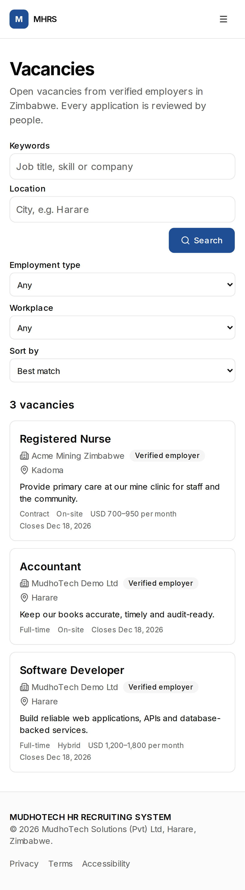
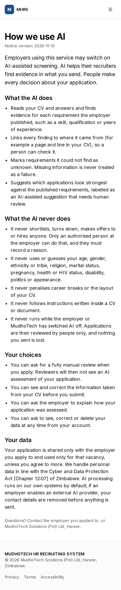
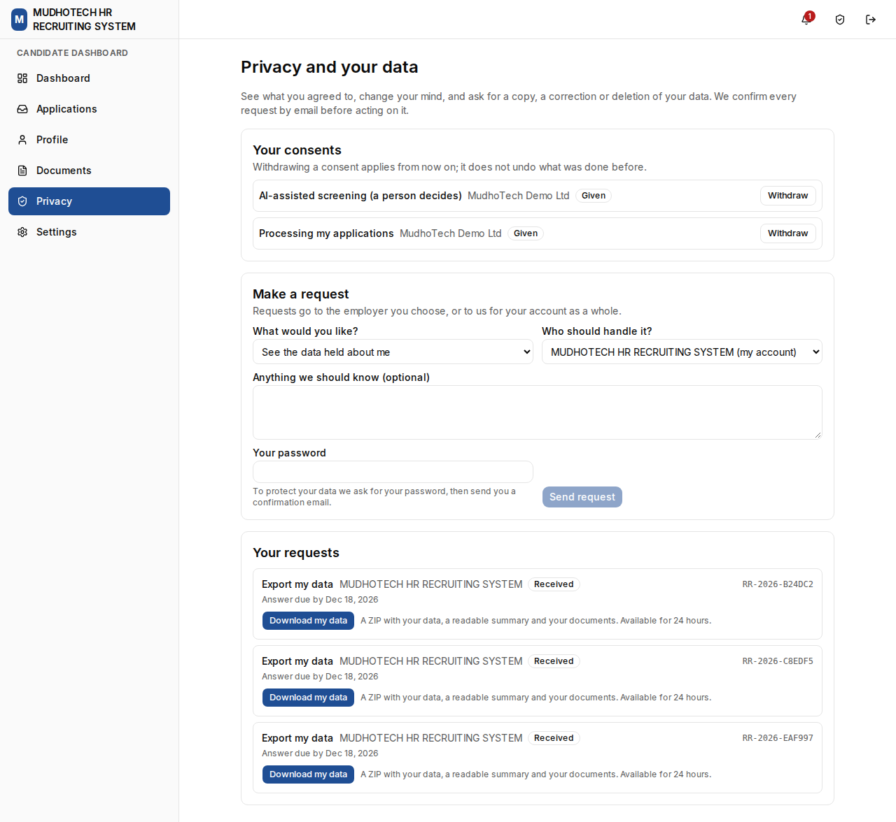

# Candidate guide

How to find vacancies, apply, follow your applications and manage your data in
MUDHOTECH HR RECRUITING SYSTEM.

> Screenshots are generated by the nightly test run (`frontend/e2e/journeys.spec.ts`, artifact
> `screens`) from synthetic demo data, so they show the current product.

## 1. Find a vacancy
1. Open **Jobs**. Search by keyword and filter by location, employment type or employer.
2. Open a vacancy to read the duties, requirements, the closing date (shown in the vacancy's time
   zone) and the questions you will be asked.
3. Read **How we use AI** to see how employers may use AI to help them, and what it never does.

  
  

## 2. Apply
1. Select **Apply**. Sign in, or create an account and confirm your email address.
2. **Upload your CV** (PDF or Word, up to the size shown). Files are checked for viruses first.
3. **Check what we read from your CV.** Correct anything that is wrong — employers see your
   corrections.
4. **Answer the employer's questions.** Required answers are marked; errors tell you what to fix.
5. **Review and submit.** Read the employer's privacy notice. If you prefer, tick
   *I want a fully manual review* — then nobody sees an AI assessment of your application.
6. You get a reference number on screen and by email. You can only have one active application per
   vacancy.

Your progress is saved as you go, so you can come back before the closing date.

## 3. Follow your applications
- **Applications** shows each application with its status and timeline: *Submitted*, *Under review*,
  *Shortlisted*, *Interview*, *Offer*, *Hired*, or *Not selected*.
- If the employer asks for more information, you get an email and a task on your dashboard. Answer
  from the application page.
- You are told about an outcome after a short delay that lets the employer correct a mistake.
- **Withdraw** an application at any time from its page; give a reason if you like.

## 4. Your data and privacy
Open **Privacy** in your account to:
- see the consents you gave and withdraw optional ones;
- **export** your data (a ZIP with your data, a readable summary and your documents, available for
  24 hours);
- ask for a **correction** or **deletion**, or **object** to automated processing.

For your protection we ask for your password and send a confirmation email before acting.
Requests are answered within 30 days. Read the platform **Privacy notice** (footer) for how long data
is kept — including that backups expire within 35 days.

## 5. Account security
**Account security** lets you change your password, see where you are signed in and sign out other
devices, and turn on two-factor authentication.

## Need help?
Contact the employer about a vacancy, or support (address in our emails) about the service. The
**Accessibility** statement in the footer explains how to get help if something does not work for you.
